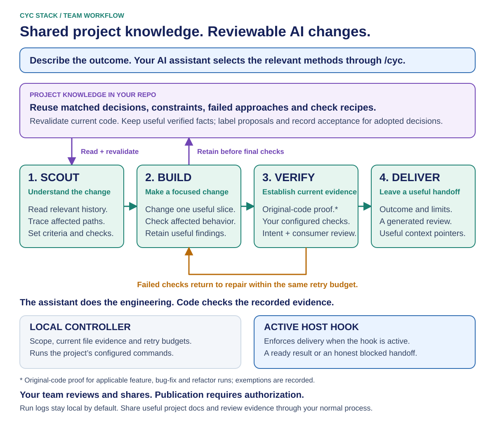

# CYC Stack

**AI coding work your team can pick up and verify.**

CYC gives your coding assistant a repeatable workflow for planning, building, checking and handing off changes. Decisions and useful lessons stay with the project, so the next teammate can build on the work without recovering the original chat.

**Claude Code · Codex · Cursor** — one entry point: `/cyc`

[Get started](#get-started) · [Example tasks](#example-tasks) · [How it works](#how-it-works) · [Documentation](#documentation)

> **Pilot · v0.6.0**
>
> Project installation and host adapters are implemented. Live host qualification and registry/marketplace publication remain pending. [Validation status](#validation-status)

## What CYC helps you do

- **Reuse project knowledge.** Find relevant decisions, constraints and failed approaches before repeating work.
- **Understand the impact.** Trace the code, callers and contracts a change could affect.
- **Check the promised behavior.** Use your project's own tests and review the result against the task.
- **Leave a useful handoff.** Keep the changes, evidence, findings and remaining limits easy to inspect.

You describe the outcome. The assistant selects the supporting methods; you do not need to memorize a skill catalog.

## Get started

**You need:** Node.js 20+, a supported AI host, and the GitHub CLI for the checkout route below. Your application can use any language. Claude project hooks also need Bash, including Git Bash on Windows.

### 1. Install into an existing project

Use a source checkout while registry publication is pending. From a separate tools directory:

```sh
gh repo clone TheDThompsonDev/cyc-stack cyc-source
node cyc-source/bin/cyc.mjs init --project "/path/to/your-project" --dry-run
node cyc-source/bin/cyc.mjs init --project "/path/to/your-project"
```

Replace the target path with your project directory. Review the preview before applying it. The installer adds the local engine, one `cyc` skill and host hooks while preserving existing project instructions and unrelated hooks.

<details>
<summary><strong>Other installation routes</strong></summary>

**Ask your agent:** follow the [agent-guided installation procedure](docs/installation.md#agent-guided-installation).

**Native plugin:** use the [host installation and activation guide](INSTALL.md#install-as-a-plugin).

**npm, after publication:** run this from your application's root:

```sh
npx cyc-stack init
```

To save the package as a dependency, use `npm install cyc-stack` first. Downloading the package and activating it in a project are separate steps.

[Versions, offline archives, updates and removal →](docs/installation.md)

</details>

### 2. Connect your project's checks

Reload your AI host, review its hook-trust prompts, then ask:

```text
/cyc Set up CYC for this project. Find the checks we already use in CI,
help me configure verification, and preserve our existing hooks and conventions.
```

Setup records approved commands in `.cyc/config.json` and reports their results. Installing files alone does not establish meaningful verification or prove that hooks are active.

If your host does not expose `/cyc`, select the discovered `cyc` skill or say **“Use the cyc skill to…”**

### 3. Try one bounded task

```text
/cyc Add CSV export to the orders dashboard. Respect the current filters
and access rules. Export all matching orders, not just the visible page.
```

Start with a real bug, small feature or focused review. State the outcome and the behavior that must remain intact.

[Full setup and installation guide →](INSTALL.md)

## How it works

The common implementation route follows four stages:

| Stage | What happens |
| --- | --- |
| **Scout** | Define success, inspect the code and relevant history, trace impact, and choose an approach. |
| **Build** | Implement tested slices, review changes, and retain useful decisions. |
| **Verify** | Run configured checks, review affected behavior, and establish applicable original-code test proof. |
| **Deliver** | Leave the result, evidence, limits and context pointers for review. |

Failed checks return to the responsible work within a shared retry budget. Other tasks, such as investigation or planning, use a different route.

<details>
<summary><strong>See the workflow diagram</strong></summary>



[Detailed engineering flow](docs/assets/cyc-workflow-diagram.svg) · [Step-by-step explanation](docs/cyc-workflow.md) · [All methods](docs/cyc-method-map.md)

</details>

## Example tasks

Use the same `/cyc` entry point and describe the job.

| Task | Example request |
| --- | --- |
| **Fix a bug** | “Totals stay stale after cancellation. Reproduce it, trace the API and cache updates, and fix the cause.” |
| **Build a feature** | “Add an optional department filter. Preserve the response format, existing callers and access rules.” |
| **Design a website** | “Build a café site with a distinct identity, meaningful imagery and a working pickup preview. Check desktop, phone and keyboard use.” |
| **Refactor** | “Simplify these permission checks while proving unauthorized requests remain blocked.” |
| **Investigate** | “Find the import bottleneck using logs and profiling. Recommend a next step; no code changes yet.” |
| **Review** | “Review this diff for compatibility, error handling and affected consumers. Prioritize supported findings.” |
| **Learn a codebase** | “Trace an order through billing, retries and failures. Explain the design choices; no edits.” |

The assistant should explain consequential decisions as the work happens. The default final summary is brief, with links to detailed evidence. Use `expand` for more detail once or `limit off` for longer replies throughout the conversation. [Response controls](docs/response-standard.md#character-limit-toggle)

## What the checks establish

CYC combines **instructions the assistant follows** with **code that checks recorded work**.

| Checked in code | Still requires judgment |
| --- | --- |
| Stage records, artifact hashes and source freshness | Whether the important dependencies were found |
| Configured command results and failure budgets | Whether the checks exercise the requested behavior |
| Delivery and installation consistency | Whether the explanation is useful and the host integration is active |

Inspect the methods, `.cyc/config.json` and local `.cyc/runs/` records. These are workflow guardrails, not a security sandbox or proof that an agent's judgment is correct. Passing checks does not authorize a merge or deployment.

## Validation status

| Area | Current boundary |
| --- | --- |
| **Automated checks** | Cover controller behavior, original-code test proof, recovery, context and installation. |
| **Host adapters** | Hook tests use simulated events. Confirm actual prompt/Stop behavior in a fresh host session. |
| **Distribution** | Source checkout and archive routes are available; registry and marketplace publication remain release work. |

Before a team rollout, use a fixed CYC revision and a representative task. Inspect the result, verification and a fresh-chat or teammate handoff. Speed, token savings and universal reliability are not established.

[Validation details →](docs/validation.md)

## Documentation

| I want to… | Read |
| --- | --- |
| Install, update or remove CYC | [Installation guide](docs/installation.md) |
| Configure checks or recover interrupted work | [Onboarding and recovery](docs/onboarding-recovery.md) |
| Understand the methods and workflow | [Engineering workflow](docs/cyc-workflow.md) · [Method map](docs/cyc-method-map.md) |
| Build a usable frontend | [Frontend design method](methods/cyc-design/frontend-design/SKILL.md) |
| Share project knowledge | [Project context](docs/context.md) |
| Reuse project checks and recipes | [Project tools](docs/project-tools.md) |
| Inspect the controller and evidence contracts | [Runtime reference](docs/runtime.md) · [Skill contract](docs/skill-contract.md) |

[Browse all documentation →](docs/README.md)

## Develop CYC

The local runtime has no third-party dependencies. From a source checkout:

```sh
node --test
npm run check:distribution
node bin/cyc.mjs help
npm pack --ignore-scripts
```

`npm pack` creates a local archive. It does not publish the package.

Change a method, try it on a representative task, and compare the outcome before rolling it into projects. Keep evidence of both improvements and regressions.

## License

[MIT](LICENSE)
