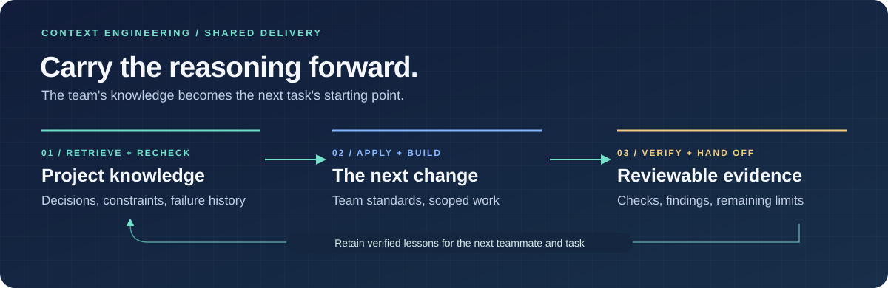
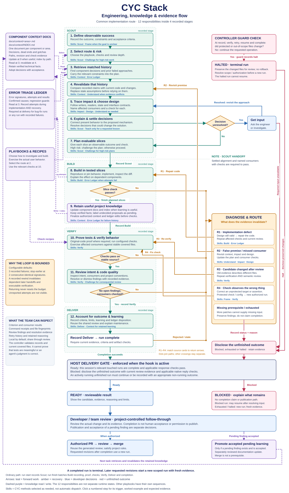

<a id="readme-top"></a>

<div align="center">
  <p><strong>CYC Stack</strong></p>
  <h1>Make your AI worth the tokens it uses.</h1>
  <p>CYC is a portable library of engineering skills and playbooks for Claude Code, Codex and Cursor&mdash;built around <strong>context engineering, token optimization and clear, actionable results.</strong></p>
  <p>You spent the tokens getting it right. <strong>The decisions and lessons that got you there shouldn&rsquo;t disappear when the chat ends.</strong></p>
  <p>Give your agent the context that matters. Carry what you learn into the next task. Get answers that show what changed, what was checked and what still needs attention.</p>
  <p><strong>Put it to work on your next task. Make it a shared standard for your team.</strong></p>
  <p>
    <a href="https://github.com/TheDThompsonDev/cyc-stack/actions/workflows/ci.yml"></a>
    <a href="https://www.npmjs.com/package/cyc-stack"></a>
    <a href="#get-started"></a>
    <a href="LICENSE"></a>
  </p>
  <p>
    <a href="#get-started"><strong>Try CYC in your project &rarr;</strong></a> &nbsp; &middot; &nbsp;
    <a href="#why-cyc">Why CYC</a> &nbsp; &middot; &nbsp;
    <a href="#how-it-works">How it works</a> &nbsp; &middot; &nbsp;
    <a href="docs/README.md">Docs</a>
  </p>
</div>

<picture>
  <source media="(max-width: 600px)" srcset="docs/assets/cyc-readme-banner-mobile.svg">
  
</picture>

CYC uses project knowledge to guide the task, checks the work, and carries useful lessons forward. Here&rsquo;s the full workflow:

<a id="workflow-diagram"></a>



[Open the full-size diagram](docs/assets/cyc-workflow-diagram.svg) · [Step-by-step walkthrough](docs/cyc-workflow.md)

## Why CYC?

**Make the next task start with what you already learned.**

Your codebase has decisions, constraints and lessons behind it. CYC gives your coding agent a method for finding that knowledge, checking whether it still holds, and using it on the work in front of you.

| Put your effort toward… | How CYC helps |
| --- | --- |
| **Context that earns its place** | An index points the agent to relevant project notes, decisions and failure history. |
| **Corrections that carry forward** | Record what failed, what changed and what the next attempt needs to account for. |
| **Work you can inspect** | Run your project's checks and retain the results, decisions and remaining limits. |
| **Answers you can use** | Lead with the result, show the evidence and make unfinished work clear. |

<details>
<summary><strong>Find your next step</strong></summary>

- [Install CYC and start a task](#installation)
- [Put context engineering and token optimization to work](#context-engineering-for-enterprise-teams)
- [Get answers you can use](#get-answers-you-can-use)
- [Make it a shared standard](#make-it-a-shared-standard)
- [See how the workflow runs](#how-it-works)
- [Explore the skills](#skills)
- [Find a playbook for the work](#playbooks)
- [Update an existing installation](#updating)
- [Inspect validation status](#validation-status)
- [Go deeper in the docs](#documentation)
- [Contribute](#contribute)
- [License](#license)

</details>

<a id="get-started"></a>

## Installation

**Put CYC to work in a project you already know.**

You need **Node.js 20+, npm, and Claude Code, Codex or Cursor**. Your application can use any language. Claude project hooks also need Bash, including Git Bash on Windows.

> [!NOTE]
> CYC is available on [npm](https://www.npmjs.com/package/cyc-stack). CYC is a pilot; confirm hooks in your own AI host before a team rollout. [Validation status](#validation-status)

### 1. Open your project

Open a terminal in the root of the project where you want to use CYC. No source checkout or global installation is needed.

<a id="preview-and-install"></a>
<a id="2-install-cyc"></a>

### 2. Install the skills and checks

```sh
npx cyc-stack@latest init
```

Accept npm's package-download prompt if it appears. The command installs the latest published release into this project without adding a dependency to your application's `package.json`.

The installer adds CYC's engine, the `cyc` entry skill and host hooks. Existing project instructions and unrelated hooks are preserved. Hosts are detected automatically; [choose a host explicitly](docs/installation.md) when needed.

<details>
<summary><strong>Preview the changes first</strong></summary>

```sh
npx cyc-stack@latest init --dry-run
```

Review the proposed changes, then run the install command above to apply them.

</details>

### 3. Connect your project's checks

Reload your AI host and review any hook-trust prompts. Then paste this into your **AI chat**:

```text
/cyc Set up CYC for this project. Find the checks we already use in CI,
help me configure verification, and preserve our hooks and conventions.
```

Setup records approved commands in `.cyc/config.json` and reports their results. Confirm real prompt/Stop hook behavior in a fresh session; installed files alone do not establish activation. [Setup and activation guide](docs/installation.md#activation-and-diagnosis)

<a id="4-start-your-first-task"></a>

### 4. Give it a real task

Describe the outcome you want. For example:

```text
/cyc Add CSV export to the orders dashboard. Respect the current filters
and access rules. Export all matching orders, not just the visible page.
```

Replace the example with your own task. Use `/cyc` in your AI host. If it is unavailable, select the discovered `cyc` skill or say **“Use the cyc skill to…”**

Inspect the change, the checks and the handoff. Look for a useful decision or lesson the next task should be able to find.

<a id="other-installation-routes"></a>

<details>
<summary><strong>Choose another installation route</strong></summary>

| Route | Start here |
| --- | --- |
| Ask your agent | [Agent-guided installation](docs/installation.md#agent-guided-installation) |
| Native plugin | [Host installation and activation](INSTALL.md#install-as-a-plugin) |
| Source checkout or archive | [Installation without npm](INSTALL.md#install-without-npm) |
| Save a development dependency or pin a version | [Optional npm controls](docs/installation.md#optional-npm-controls) |

Downloading a package and activating it in a project are separate steps. [Versions, archives and removal →](docs/installation.md)

</details>

[Full installation guide →](INSTALL.md)

<a id="context-engineering-for-enterprise-teams"></a>

## Context engineering: put your project knowledge to work

**Keep the knowledge that made the change possible.**

CYC's context method directs the agent to retain decisions, constraints, useful failed approaches and supporting evidence in repository notes. A path-based index connects later tasks to the relevant knowledge. The agent checks consequential claims against current code before relying on them.

```text
Find relevant knowledge → Check it against the code → Use it → Retain what you learned
```

### Token optimization: give context a purpose

Load the index and matching notes for the task. Bring forward the decisions, known dead ends and check recipes that matter. Open deeper methods when the work calls for them.

That is CYC's strategy for focused context and useful reuse. Investigation and verification can consume additional tokens upfront. **Speed, token savings and universal reliability are not established.** Reading-size estimates do not establish provider billing or successful reuse.

[Context engineering and measurement limits →](docs/context.md)

<a id="what-that-means-in-a-real-task"></a>

### A lesson the next task can use

**Illustrative example: “Add CSV export to the orders dashboard.”**

CYC directs the assistant to investigate pagination, filters and access rules before implementing the download. Verification should exercise all authorized matching records, including results beyond the visible page and rejected access.

The useful lesson is the export contract: which filters apply, how access is enforced, and why the visible page is insufficient. Retain that decision with its evidence. A later task can retrieve it, check whether it still holds, and build on it.

This illustrates the intended workflow. To assess reuse in your project, inspect whether a fresh session actually finds and applies the retained knowledge.

## Get answers you can use

**The result should be easy to find. The evidence should be easy to inspect.**

CYC's delivery skills ask the assistant to make the handoff useful to the person reading it:

| What you need to know | What the handoff should show |
| --- | --- |
| **What happened?** | The result or blocker up front, with links to the work. |
| **What supports it?** | The checks actually run, their outcomes and a visual that clarifies the result. |
| **What still needs attention?** | Unchecked behavior, unresolved limits and any decision you need to make. |
| **What carries forward?** | Useful decisions, lessons and evidence the next task can find. |

Progress updates explain consequential choices while the work is happening. Final summaries stay brief and link to deeper evidence. Use `expand` for more detail once, or `limit off` for longer replies throughout the conversation. [Response controls](docs/response-standard.md#character-limit-toggle)

Delivery hooks check reply structure and recorded readiness where active. The assistant remains responsible for clarity and substance; structural checks alone cannot establish either.

## Make it a shared standard

**Start with work you know. Share the practices that earn their place.**

For an independent engineer, that starts with a useful task and a later session that can find its lessons. For an engineering manager, it becomes a repeatable way to bring project knowledge, verification and clear handoffs into the team's AI work.

1. **Try a representative task.** Use a fixed release and inspect the implementation, checks and final response.
2. **Check the handoff.** Ask a fresh session or teammate to use the retained knowledge on related work. Look for missed context, stale guidance and lessons that actually help.
3. **Share the working practices.** Review the context and check configuration with the code. Pin the release you qualified, and confirm activation in each teammate's AI host.

Your team owns the context, verification commands and review process. Shared knowledge lives in repository documents; detailed run records stay local by default. Existing CI, access rules and merge controls remain yours.

[Engineering standards](docs/code-quality.md) · [Project tools and recipes](docs/project-tools.md) · [Rollout and validation boundaries](#validation-status)

## How it works

**Describe the outcome. Follow a method. Inspect the evidence.**

Start with [`/cyc`](skills/cyc/SKILL.md). The assistant selects a playbook and loads the relevant supporting skills. **Skills guide how to do the work. Playbooks give the task its route and completion criteria.**

CYC also includes a local controller: it records stage handoffs, runs your configured project checks and checks evidence freshness. Applicable new regression tests must fail against the original code before the controller accepts the change.

The common implementation route is:

```text
Scout → Build → Verify → Deliver
```

| Stage | What you should get |
| --- | --- |
| **Scout** | Relevant history, affected behavior and a plan with checks. |
| **Build** | Changes that account for the plan, project conventions and affected consumers. |
| **Verify** | Current check results, applicable original-code test proof, findings and limits. |
| **Deliver** | A clear result, reviewable evidence and useful knowledge for the next task. |

Failed checks return to the responsible work within a shared retry budget. Other tasks use routes suited to their outcome. The controller bounds its recorded retries; it does not continuously monitor or terminate the host agent.

[See the workflow diagram above](#workflow-diagram) · [Step-by-step walkthrough](docs/cyc-workflow.md)

<p align="right"><a href="#readme-top">Back to top ↑</a></p>

## Skills

**Give your agent a method for the work in front of it.**

CYC has **one entry skill, 17 supporting methods, and a frontend design specialization inside Design**. Start with `/cyc`; the assistant loads what the task needs. Your existing AI host performs the skills. Each method is a focused procedure, not automatically a separate agent.

<a id="start-with-understanding"></a>

<details>
<summary><strong>Understand the task and the codebase</strong></summary>

| Skill | What it brings to the task |
| --- | --- |
| [**Setup**](methods/cyc-setup/SKILL.md) | Find the project's checks, configure verification and report setup and host-activation evidence. |
| [**Scout**](methods/cyc-scout/SKILL.md) | Bring relevant history, affected files and verification needs into an initial plan. |
| [**Frame**](methods/cyc-frame/SKILL.md) | Define the outcome, scope and criteria for success. |
| [**Understand**](methods/cyc-understand/SKILL.md) | Trace behavior or reproduce a failure; separate confirmed causes from hypotheses. |
| [**Impact**](methods/cyc-impact/SKILL.md) | Find the callers, state, storage and interfaces a change could affect. |

</details>

<a id="choose-and-deliver-the-change"></a>

<details>
<summary><strong>Choose an approach, build it and check the result</strong></summary>

| Skill | What it brings to the task |
| --- | --- |
| [**Explore**](methods/cyc-explore/SKILL.md) | Compare distinct approaches or scoped prototypes before choosing a direction. |
| [**Design**](methods/cyc-design/SKILL.md) | Define state, interfaces, compatibility and implementation slices. |
| [**Challenge**](methods/cyc-challenge/SKILL.md) | Test a plan or change against concrete counter-cases and return supported findings. |
| [**Build**](methods/cyc-build/SKILL.md) | Implement tested slices, review the diff and record consequential decisions. |
| [**Verify**](methods/cyc-verify/SKILL.md) | Exercise the promised behavior, affected consumers and relevant rejection and recovery paths. |
| [**Deliver**](methods/cyc-deliver/SKILL.md) | Put the result, evidence, a useful visual and honest limits into a reviewable handoff. |

[**Frontend design**](methods/cyc-design/frontend-design/SKILL.md) adds visual direction, desktop and phone review, and usability and access checks. Design quality still requires review; a passing build cannot establish it.

</details>

<a id="continuity-learning-and-correction"></a>

<details>
<summary><strong>Carry knowledge forward and learn from corrections</strong></summary>

| Skill | What it brings to the task |
| --- | --- |
| [**Context**](methods/cyc-context/SKILL.md) | Retrieve and revalidate component knowledge; retain useful findings in indexed project notes. |
| [**Remember**](methods/cyc-remember/SKILL.md) | Keep task checkpoints and reconstruct decisions and next steps after interruption. |
| [**Error Ledger**](methods/cyc-error-ledger/SKILL.md) | Make failed approaches, confirmed causes and regression evidence searchable. |
| [**Correct**](methods/cyc-correct/SKILL.md) | Turn feedback into a missing criterion, a targeted repair and renewed checks. |
| [**Reflect**](methods/cyc-reflect/SKILL.md) | Propose improvements to the methods from completed outcomes and evidence. |
| [**Teach**](methods/cyc-teach/SKILL.md) | Explain a concept through the project's own code, examples and optional practice. |

Context preserves component knowledge. Remember preserves task continuity. Reflect proposes improvements to the working method.

</details>

[Full method map and examples →](docs/cyc-method-map.md)

<a id="example-tasks"></a>

## Playbooks

**Name the outcome. The assistant selects the route.**

The 15 playbooks cover implementation, investigation, learning and handoffs. Describe your task through `/cyc`; you do not need to memorize the catalog.

| Playbook | Bring it work like this |
| --- | --- |
| [**Investigation**](skills/cyc/references/playbooks/investigation.md) | Explain what causes a behavior, with evidence. |
| [**Explore**](skills/cyc/references/playbooks/explore.md) | Compare approaches before committing to one. |
| [**Plan**](skills/cyc/references/playbooks/plan.md) | Break a substantial change into verifiable units. |
| [**Feature**](skills/cyc/references/playbooks/feature.md) | Build changed behavior and check the affected consumers. |
| [**Bug fix**](skills/cyc/references/playbooks/bug-fix.md) | Reproduce the failure, repair its cause and establish regression evidence. |
| [**Refactor**](skills/cyc/references/playbooks/refactor.md) | Improve structure and verify preserved behavior. |
| [**Performance**](skills/cyc/references/playbooks/performance.md) | Measure the baseline, target a bottleneck and check the change. |
| [**Review**](skills/cyc/references/playbooks/review.md) | Find consequential issues in existing work and explain the evidence. |
| [**Verify**](skills/cyc/references/playbooks/verify.md) | Check an executable result against explicit criteria. |
| [**Experience**](skills/cyc/references/playbooks/experience.md) | Improve a complete user journey and check its connected behavior. |
| [**Teach**](skills/cyc/references/playbooks/teach.md) | Learn through the project's code and worked examples. |
| [**Handoff**](skills/cyc/references/playbooks/handoff.md) | Leave decisions, evidence and limits someone else can use. |
| [**Resume**](skills/cyc/references/playbooks/resume.md) | Reconstruct interrupted work and check what has changed. |
| [**Reflect**](skills/cyc/references/playbooks/reflect.md) | Turn completed outcomes into proposals for better methods. |
| [**Evaluate**](skills/cyc/references/playbooks/evaluate.md) | Compare a workflow against a baseline with recorded outcomes and limits. |

<details>
<summary><strong>Inspect the recorded routes</strong></summary>

| Playbook | Recorded stages |
| --- | --- |
| `investigation` | Scout → Deliver |
| `explore` | Frame → Understand → Explore → Challenge → Deliver |
| `plan` | Frame → Understand → Impact → Design → Challenge → Deliver |
| `feature` | Scout → Build → Verify → Deliver |
| `bug-fix` | Scout → Build → Verify → Deliver |
| `refactor` | Scout → Build → Verify → Deliver |
| `performance` | Scout → Build → Verify → Deliver |
| `review` | Scout → Challenge → Verify → Deliver |
| `verify` | Scout → Verify → Deliver |
| `experience` | Scout → Explore → Build → Verify → Deliver |
| `teach` | Frame → Understand → Teach → Deliver |
| `handoff` | Understand → Verify → Deliver |
| `resume` | Remember → Understand → Deliver |
| `reflect` | Remember → Reflect → Deliver |
| `evaluate` | Frame → Understand → Explore → Verify → Reflect → Deliver |

Routes come from the [playbook catalog](catalog/playbooks.json). A stage may use additional supporting methods. The controller records and validates handoffs; it does not automatically launch skills or establish that the assistant performed them well.

</details>

### Try a different kind of task

```text
/cyc Review this diff for API compatibility, error handling and affected consumers.
Explain the evidence behind the findings. No edits.
```

```text
/cyc Improve this site's complete signup journey. Establish a visual direction,
build a usable mobile layout, and check keyboard, validation and recovery states.
```

## Updating

**Keep the methods current as your project moves forward.**

From your project root, preview the latest release's changes:

```sh
npx cyc-stack@latest init --dry-run
```

Then apply the update:

```sh
npx cyc-stack@latest init
```

Valid project configuration and local run records are preserved. Updating an npm dependency alone does not refresh the copied engine. **Reload your AI host** after updating and repeat the setup check so the session uses the new skills and hooks. Teams can [pin an approved version](docs/installation.md#optional-npm-controls).

> [!IMPORTANT]
> If you edited a CYC-managed file, the installer reports a conflict and writes nothing. Back up and merge that customization before retrying. [Update and conflict guidance](docs/installation.md#updating-conflicts-and-removal)

## Validation status

**Inspect the evidence before you make it a team standard.**

CYC combines instructions the assistant follows with code that checks recorded work.

| Area | What is established |
| --- | --- |
| **Automated checks** | Exercise controller behavior, original-code test proof, recovery, context and installation. The CI badge links to current results. |
| **Host adapters** | Hook tests use simulated events. Actual prompt/Stop behavior needs confirmation in a fresh host session. |
| **Distribution** | Published on [npm](https://www.npmjs.com/package/cyc-stack), with source and archive routes available. Public directory listings and fresh native-host qualification remain separate release steps. |

Inspect the methods, `.cyc/config.json` and local `.cyc/runs/` records. Source hashes and passing commands do not establish that every dependency was found or every check was sufficient. Local hooks are workflow guardrails; they do not provide a security sandbox, tamper-proof attestation or authorization to merge or deploy.

Before a team rollout, use a fixed revision and a representative task. Inspect the work and confirm that a fresh chat or teammate can use the retained knowledge. Speed, token savings and universal reliability are not established.

[Validation details →](docs/validation.md)

## Documentation

**Go deeper where your project needs it.**

| I want to… | Guide |
| --- | --- |
| Inspect all skills and routes | [Method map](docs/cyc-method-map.md) · [Playbook catalog](catalog/playbooks.json) |
| Install, update or remove CYC | [Installation](docs/installation.md) |
| Configure checks or recover interrupted work | [Onboarding and recovery](docs/onboarding-recovery.md) |
| Share project knowledge and inspect context measurements | [Context engineering](docs/context.md) |
| Build a usable frontend | [Frontend design](methods/cyc-design/frontend-design/SKILL.md) |
| Reuse checks and recipes | [Project tools](docs/project-tools.md) |
| Inspect the controller and contracts | [Runtime](docs/runtime.md) · [Skill contract](docs/skill-contract.md) |

[Browse all documentation →](docs/README.md)

## Contribute

**Bring a reproducible problem or a tested improvement.**

[Open an issue](https://github.com/TheDThompsonDev/cyc-stack/issues) with the host, Node version, steps and observed result.

For source changes, run:

```sh
node --test
npm run check:distribution
```

The local runtime has no third-party dependencies. For method changes, compare a representative task before rollout and retain evidence of improvements and regressions. [Skill-writing guidance](docs/skill-craft.md)

## License

Distributed under the [MIT License](LICENSE).

<p align="right"><a href="#readme-top">Back to top ↑</a></p>
