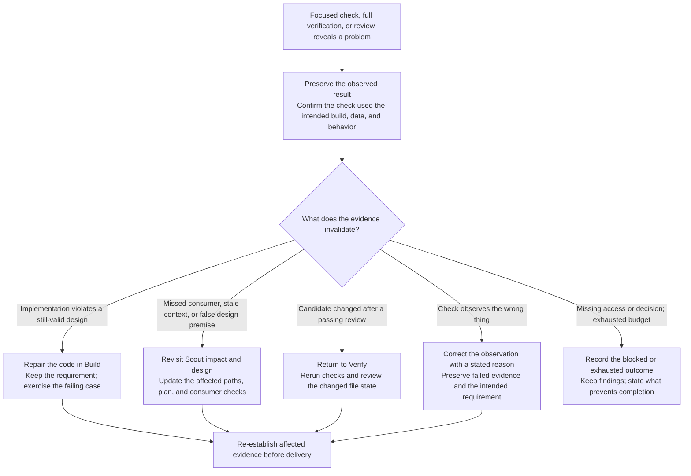

# CYC engineering workflow: decisions, evidence, and recovery

[Workflow](assets/cyc-workflow-diagram.svg), [overview](assets/cyc-overview.svg), [17-method map](assets/cyc-method-library.svg) and [method roles](cyc-method-map.md) cover **Scout → Build → Verify → Deliver**. Twelve responsibilities sit inside these stages. Other routes use the [catalog](../catalog/playbooks.json); Teach adds requested lessons.

Explain consequential behavior. Agents investigate/judge; the controller checks records, stages, files, commands and failure limits. Fields, hashes and green commands certify no truth/comprehension. SVGs ship; bitmap/HTML exports and docs/maintainers/cyc-workflow-reference.md stay source-only.

## 1. The engineering path

```mermaid
flowchart TB
  subgraph SC["SCOUT — establish what must change and what must remain true"]
    S1["1. Define observable success<br/>Goal, constraints, acceptance criteria"]
    S2["2. Select route and risk treatment<br/>Choose the playbook and applicable verification"]
    S3["3. Retrieve matched project history<br/>Component decisions, known failures, existing capabilities"]
    S4["4. Revalidate that history<br/>Compare claims with current code and working changes"]
    S5["5. Trace impact and choose a design<br/>Writers, readers, contracts, checks, trade-offs"]
    S6["6. Explain the causal path and settle key decisions<br/>Current behavior, proposed mechanism, preserved behavior"]
    S7["7. Plan slices and challenge consequential assumptions<br/>Each slice has an observable outcome and check"]
    S1 --> S2 --> S3 --> S4 --> S5 --> S6 --> S7
  end
  SG{"Scout assessment usable?<br/>Alignment settled; consumers and checks named"}
  S7 --> SG
  SG -->|"Yes: record Scout"| B8
  SG -->|"Missing evidence or consequential answer"| HOLD["Investigate the specific gap or record a blocker<br/>No passing handoff on an unresolved decision"]

  subgraph BU["BUILD — implement the chosen behavior with focused feedback"]
    B8["8. Implement a tested slice<br/>Reproduce the defect or pin required behavior; inspect the diff"]
    BG{"Slice preserves its required behavior?"}
    B9["9. Retain useful project knowledge<br/>Update docs and index when useful; retain evidence and limits"]
    B8 --> BG
    BG -->|"Yes: finish planned slices"| B9
  end
  BG -->|"No: use recovery map"| REC["Diagnose evidence and route the repair"]
  B9 -->|"Record Build when its work is usable"| V10

  subgraph VE["VERIFY — evaluate the actual candidate against the promised outcome"]
    V10["10. Prove tests and verify behavior<br/>Original-code proof where required; journey and configured checks on stable files"]
    VG{"Required checks support every criterion?<br/>Configured commands pass; source remains stable"}
    V11["11. Review the meaning of the change<br/>Intent, consumers, conventions; resolve or justify findings"]
    RG{"Consumer evidence complete?<br/>No unresolved review findings"}
    V10 --> VG
    VG -->|"Yes"| V11 --> RG
  end
  VG -->|"No"| REC
  RG -->|"No"| REC
  RG -->|"Yes: record Verify against this file state"| D12

  subgraph DE["DELIVER — hand over inspectable evidence"]
    D12["12. Account for outcomes and retained knowledge<br/>Criteria, limits, learning disposition, ledger, shared review"]
    DC["Record Deliver and request run complete<br/>Controller rechecks completion conditions and current evidence"]
    D12 --> DC
  end
  DC --> OUT["Ready handoff when completion and delivery checks pass<br/>Team review and publication follow project authorization"]
```

Record attempts when they happen. Steps 8/9 can interleave, but finish authorized source, context/index and ledger edits before final executable checks. Missing prerequisites remain blockers.

### Scout: why these seven responsibilities precede implementation

1. **Define success.** Preserve observable outcomes, constraints, exclusions and criterion IDs; explain what checks distinguish. Criteria quality needs judgment.
2. **Choose route/risk treatment.** Select playbook and meaningful checks before start; captured config is protected. Match review depth to changed behavior; challenge high-risk assumptions.
3. **Retrieve history.** Read index, matched records, capabilities and ledger. Cite applicable decisions/failures or their absence.
4. **Revalidate.** Compare claims with current code/revisions/dirty files. Retain file evidence, freshness reasoning, contradictions and unknowns.
5. **Trace/design.** Follow writers, state, services, persistence and readers. Name consumers/checks and justify reuse/extension/repair/creation. Impact grants no broader authority.
6. **Settle decisions.** Explain behavior, mechanism, change and invariants. Ask consequential questions only. Clear requests need no invented approval; confirmation needs actual confirmation. needs-input cannot pass Scout. Silence is not approval.
7. **Plan slices.** Sequence observable outcomes, failures, dependencies and checks. Challenge defeated high-risk premises; fast routes add no Challenge state.

### Build: keep changes and explanations connected

8. **Tested slices.** Reproduce bugs, characterize refactors and exercise feature outcomes; prove relevant original behavior. Use existing checks/reasoned exemption when no new testable behavior exists. Inspect diffs/consumers, diagnose failures and ledger actual attempts/results. Explain affected state/interface and repair location.
9. **Knowledge.** Plan required component owners/index before Build. Retain capability, contracts, adopted decisions, evidenced failures, dependencies, checks and issues. Preserve/supersede history explicitly and bind paths/current files, including dirty evidence.

docs/context/<area>.md holds component reasoning; docs/context/INDEX.md maps paths/freshness; the ledger holds failures/causes. Name by component, not task/chat. Keep hypotheses pending; adoption needs acceptance. No filler/generic waiver of feature retention. Explain retrieval/revalidation. Deliver records disposition, not source edits.

[Task delegation](task-context.md) preserves parent authority and one document; worker results cannot replace parent proof/review/checks/retention.

### Verify: require both executed behavior and explained judgment

10. **Prove/verify.** Changed feature/bug tests must fail on originals; refactor characterization must pass. Classify interface/setup/behavior honestly; exemptions retain reasons/limits. Run relevant journeys/recipes, negatives and all configured commands. Map criteria/consumers. Receipts bind arguments/status/output/source; failure/drift rejects passing verification. Explain omissions.
11. **Review meaning.** Inspect intent/consumers/conventions in the current diff. Resolve/dismiss findings with evidence; open findings block. Evidence every Scout consumer and add discoveries. Label self/fresh/peer provenance.

### Deliver: expose the basis for acceptance

12. **Account for outcomes.** Record criteria, limits, learning/history; bugs/failures require the ledger. Reuse the review; Deliver needs current executable/semantic evidence. Completion rechecks conditions/artifacts. Supply mechanism, trade-offs, checks and maintenance pointers. Publication needs authorization.

run start can record Scout; run finish can combine Build, proof/judgment, verification, Verify/Deliver and completion. Sharing local evidence needs authorization.

An active host hook separately checks readiness/session runs. Ready delivery needs completion; blocked/exhausted work allows honest blocked handoffs, never concealed running work. Native Codex/Claude Stop supplies reply text; finish may write request-bound evidence. Cursor needs the exact-response packet. Follow [response rules](response-standard.md#engineering-understanding-throughout-the-work), actual capability/current hook context. Files/simulations prove no activation.

## 2. Why the process loops, and why the return destination matters

Preserve results; confirm intended build, data and requirement.

These are destinations, not mandatory restarts. Before passed Verify, repair may stay active. Recorded returns use run retry, invalidating dependent handoffs/verification. Post-Verify edits require Verify plus fresh checks/review. Fast routes map impact/design returns to Scout. Re-establish affected source/consumer/check/review evidence.

Protected criteria/config changes need explained, authorized new runs retaining old outcomes; never weaken the active run. Record/verify/retry/resume/complete guards halt on protected/out-of-scope changes, preserving files without rollback or continuous monitoring. Halted/exhausted runs are terminal. Blocked work may resume after resolution within guards/remaining allowance; halted work needs resolved scope/authority before a new run.

Defaults share three failures/two unchanged repeated signatures across stages; returns never reset them. No-progress detection is heuristic.

### A worked example: why going back to Scout is sometimes essential

Illustrative export: an early loop exit needs Build repair; a browser holding one page/different filters defeats the design. Revisit Scout/query/access, rebuild and check pagination/denied access. Explain absent-record limits and retain the failure.

## 3. What an engineering team can inspect before trusting a result

Ask **what supports this claim, does it describe these files, and what remains unestablished?** Inspect criteria/results, hashes/receipts/external and excluded inputs, intent/consumer/convention findings, limits/retries/outcomes, context/ledger/learning and explanation. Editable reports cannot reveal concealed actions or certify independent approval/comprehension. Adoption needs evidence.

Inspect [assessment validation](../scripts/work-review.mjs), [runtime](../scripts/runtime.mjs), [source coverage](../scripts/source-snapshot.mjs) and [session rules](../scripts/run-gate.mjs). Source regressions: test/work-review.test.mjs and test/runtime-adversarial.test.mjs; names are not results.

## Regenerating the diagram

In source, npm install (or npm ci), then npm run build:workflow uses dev-only sharp for PNG/SVG/HTML previews and twelve titles. Missing renderer/HTML marker/title fails before updates. Fonts vary by machine; same-machine repeats should agree. Installed CYC needs no authoring dependency.

## Supporting references and earlier overview

- [Runtime](runtime.md)
- [Assessments](work-assessments.md)
- [Impact](impact-analysis.md)
- [Explanation](response-standard.md#engineering-understanding-throughout-the-work)
- [Orchestrator](../skills/cyc/SKILL.md), [Build](../methods/cyc-build/SKILL.md), and [Verify](../methods/cyc-verify/SKILL.md)
