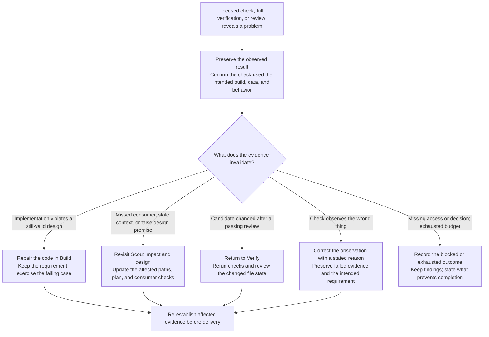

# CYC engineering workflow: decisions, evidence, and recovery

> Source-only reference preserved before the automatic swarm update. The [maintained installed guide](../cyc-workflow.md) owns current operational instructions; this snapshot retains the full worked explanation and historical evidence boundaries. Original guide SHA-256: 9e68e1e915040ea08b2abd3b40fda3263e7ba5dae38c036a14b3dbf6cbcc147f.

Open the [connected workflow diagram](../assets/cyc-workflow-diagram.svg) for the responsibilities, recovery arrows, project knowledge, and separate delivery outcomes. The sections below explain the steps. A [quick overview](../assets/cyc-overview.svg) is also available. The runtime distribution uses compact vector diagrams; bitmap and interactive HTML exports stay in the source checkout.

Skill labels inside the numbered steps and recovery cards show where existing CYC methods help. Open a numbered step for its selection trigger, a worked CSV-export example, direct method links and the evidence it passes forward. These placements describe agent-selected methods, not automatic dispatch or additional controller stages. Ordinary engineering explanation belongs throughout the work; Teach adds a lesson only when requested.

The common implementation route does not show the entire library. See the [full map of all 17 methods](../assets/cyc-method-library.svg) and [method roles, examples and routing limitations](../cyc-method-map.md), including Setup, Remember, Explore, Correct and Reflect. CYC has 15 playbooks; planning, exploration, teaching, resumption and evaluation use other recorded sequences.

CYC moves work forward when the next stage has usable evidence. A failure sends work back to the earliest affected decision, so the agent can repair the cause and regenerate the conclusions that depended on it. The engineer should be able to inspect both the change and the reasoning for taking that route.

This document describes the current local implementation and its method instructions for the common feature, bug-fix, and refactor routes. The controller records **Scout → Build → Verify → Deliver**. The twelve responsibilities below occur inside those stages; they are not twelve machine-enforced states. Other routes use the [playbook catalog](../../catalog/playbooks.json).

**Read the boundaries literally:** the agent investigates, explains, chooses checks, and judges meaning. The controller validates recorded fields, stage identity, covered file state, configured command results, and budgets. A required evidence field does not prove the evidence is true.

## 1. The engineering path

Each box describes work and the evidence it produces. The separate recovery map below explains backward movement; those returns are deliberately not repeated across this entire diagram.

```mermaid
flowchart TB
  subgraph SC["SCOUT — establish what must change and what must remain true"]
    S1["1. Define observable success<br/>Goal, constraints, acceptance criteria"]
    S2["2. Select route and risk treatment<br/>Choose the playbook and applicable verification"]
    S3["3. Retrieve matched project history<br/>Component decisions, known failures, existing capabilities"]
    S4["4. Revalidate that history<br/>Compare claims with current code and working changes"]
    S5["5. Trace impact and choose a design<br/>Writers, readers, contracts, checks, trade-offs"]
    S6["6. Explain the causal path and settle key decisions<br/>Current behavior, proposed mechanism, preserved behavior"]
    S7["7. Plan slices and challenge consequential assumptions<br/>Each slice has an observable outcome and check"]
    S1 --> S2 --> S3 --> S4 --> S5 --> S6 --> S7
  end
  SG{"Scout assessment usable?<br/>Alignment settled; consumers and checks named"}
  S7 --> SG
  SG -->|"Yes: record Scout"| B8
  SG -->|"Missing evidence or consequential answer"| HOLD["Investigate the specific gap or record a blocker<br/>No passing handoff on an unresolved decision"]

  subgraph BU["BUILD — implement the chosen behavior with focused feedback"]
    B8["8. Implement a tested slice<br/>Reproduce the defect or pin required behavior; inspect the diff"]
    BG{"Slice preserves its required behavior?"}
    B9["9. Retain useful project knowledge<br/>Update docs and index when useful; retain evidence and limits"]
    B8 --> BG
    BG -->|"Yes: finish planned slices"| B9
  end
  BG -->|"No: use recovery map"| REC["Diagnose evidence and route the repair"]
  B9 -->|"Record Build when its work is usable"| V10

  subgraph VE["VERIFY — evaluate the actual candidate against the promised outcome"]
    V10["10. Prove tests and verify behavior<br/>Original-code proof where required; journey and configured checks on stable files"]
    VG{"Required checks support every criterion?<br/>Configured commands pass; source remains stable"}
    V11["11. Review the meaning of the change<br/>Intent, consumers, conventions; resolve or justify findings"]
    RG{"Consumer evidence complete?<br/>No unresolved review findings"}
    V10 --> VG
    VG -->|"Yes"| V11 --> RG
  end
  VG -->|"No"| REC
  RG -->|"No"| REC
  RG -->|"Yes: record Verify against this file state"| D12

  subgraph DE["DELIVER — hand over inspectable evidence"]
    D12["12. Account for outcomes and retained knowledge<br/>Criteria, limits, learning disposition, ledger, shared review"]
    DC["Record Deliver and request run complete<br/>Controller rechecks completion conditions and current evidence"]
    D12 --> DC
  end
  DC --> OUT["Ready handoff when completion and delivery checks pass<br/>Team review and publication follow project authorization"]
```

Steps 8 and 9 can interleave: record attempts when they happen, not after reconstructing the whole run. Step 9 can finish during Verify preparation, but covered documentation edits must precede the final executable checks. Missing evidence is repaired; an unavailable prerequisite is disclosed as a blocker.

### Scout: why these seven responsibilities precede implementation

**1. Define observable success.** Translate the request into outcomes that a reviewer could distinguish from a plausible-looking implementation. For an export, “a CSV downloads” is weaker than “all matching records are exported and existing access restrictions still apply.” Preserve constraints and exclusions. Explicit criteria give verification a stable target; the controller requires each configured criterion ID to survive handoffs. The agent still owns whether those criteria describe the right product behavior. Explain the difference between a working control and the promised outcome.

**2. Select the route and risk treatment.** Choose a playbook before starting the tracked run. Investigation, teaching, verification, and implementation have different work requirements. Identify consequential permissions, stored-data changes, public interfaces, or other risk in this task. Configure meaningful project checks before the run; configuration is captured and protected during it. Explain why the selected checks and review depth match the changed behavior. A high-risk plan gets a focused Challenge pass; ordinary work proceeds without that extra pass.

**3. Retrieve matched history.** Read relevant component context, the capability index if present, and the selected error ledger. Look for the reason an interface behaves as it does, the existing implementation to reuse, and approaches already shown to fail. Produce references to the matched material or an honest account of no relevant history. This changes the starting hypothesis and can avoid repeating investigation; it does not establish a measured token or dollar saving. Explain which prior decision affects today's change.

**4. Revalidate history against the working project.** Compare recorded claims with the actual covered components, relevant revisions, and uncommitted changes. A note may describe an old design even when the note itself is readable. Confirm useful claims and label contradictions or uncertainty. The assessment records freshness reasoning and fingerprints referenced files; the agent must actually perform the comparison. Explain any outdated assumption before using a new one.

**5. Trace impact and choose the design.** Follow the affected input through state, services, interfaces, persistence, and readers that exist in the project. Name the consumers whose behavior must remain consistent, then select reuse, extension, repair, or new construction with a reason. Pair each consumer with a behavior check. An affected area is a verification concern, not permission to broaden the feature. Explain where the change belongs and why an alternative would create a consequential cost or risk.

**6. Explain the causal path and resolve decisions.** Connect observed behavior to the mechanism producing it, then explain what will change and what must remain true. Ask only when an unresolved answer changes the solution. A settled request can be recorded as clear; confirmed alignment requires actual confirmation. The controller rejects a passing Scout assessment marked needs-input. Supplying an explanation does not establish comprehension, and silence does not establish approval.

**7. Plan slices that can be evaluated.** Sequence implementation around observable behavior, not a list of arbitrary files. Identify how the first slice can fail, how later slices depend on it, and what broader checks will cover the result. For high-risk work, challenge consequential assumptions and revise the plan if evidence defeats them. This is method guidance inside Scout; the runtime does not independently judge the plan or enforce a separate Challenge state for the fast routes. Explain the dependency that determines the sequence.

### Build: keep changes and explanations connected

**8. Implement a tested slice.** For a bug, reproduce the defect before claiming a repair; for a refactor, preserve a behavior check; for a feature, exercise the intended new outcome. Confirm that a new regression check can detect the original defect, then implement the change and inspect its effect on named consumers. Existing checks or a justified skip can cover work with no new testable behavior. Focused failures trigger diagnosis, not blind repetition. Record failed attempts in the selected ledger and explain the affected state or interface, why the repair belongs there, and what the focused result establishes. These actions are method responsibilities; CYC cannot see an unreported attempt.

**9. Retain useful project knowledge.** For affected components or areas with reusable knowledge, create or update `docs/context/<area>.md` and its path-matched row in `docs/context/INDEX.md`. Name the document for the component or area, not the task or conversation. Append a dated entry preserving verified facts, actual adopted decisions, rejected alternatives, dead ends with evidence, non-obvious dependencies or gotchas, verification references, and open issues. Record covered paths and the reviewed revision; for a dirty checkout, include the base commit plus covered-file evidence. Explicitly supersede outdated entries while retaining their history.

This step produces inspectable component knowledge, not just a delivery summary:

| Output | What it preserves | How subsequent work uses it |
| --- | --- | --- |
| `docs/context/<area>.md` | Why the component behaves this way, what failed, dependencies, checks and known limits | Step 3 retrieves the matching document; step 4 checks its freshness against the current code |
| `docs/context/INDEX.md` | Component/area, covered paths, document location, reviewed revision and a short summary | Locates relevant history from the files being changed |
| Selected error ledger | Failed attempts, observed results and confirmed causes | Supplies failure evidence that component entries can reference without duplicating the entire log |

For example, an export-component entry could preserve why exports query all authorized matching records rather than the current UI page, the failed page-state approach and its evidence, and the regression check covering pagination. This is an illustrative entry, not a claim about this project's components.

Finish authorized durable context/index and ledger edits before final verification because those files belong to the candidate being checked. Retain useful verified technical facts with their evidence and limits. Keep unverified hypotheses and undecided proposals explicitly pending; mark a decision adopted only with actual acceptance. Do not create filler documents when there is no reusable finding. Explain the retained reasoning and how a future engineer would locate and revalidate it. Deliver records this disposition; it is not a second opportunity to mutate verified source. The existing component-context method and templates define this responsibility; the diagram does not add a new runtime state or claim the controller proves documentation quality.

### Verify: require both executed behavior and explained judgment

**10. Prove tests and exercise the promised behavior.** The controller runs required original-code proof when it is missing or outdated: changed tests for feature and bug-fix runs must fail on the original code; refactor tests must pass there. An explicit exemption records its actual reason and limits. Run relevant journey or recipe checks and every configured command. Map results to acceptance criteria and identified consumers; include rejected cases where they protect the requirement. The controller retains command arguments, exit status, output, and a covered source fingerprint. It rejects a passing receipt when commands fail or covered source changes during execution. It does not know whether a zero-exit command meaningfully tested the product. Explain which path each consequential check exercises and what remains outside its coverage.

**11. Review whether the implementation means the right thing.** Review the current diff for intent, affected consumers, and project conventions. Tests can pass while encoding an incomplete assumption, missing a consumer, or accepting the wrong behavior. Record findings as resolved or dismissed with evidence; open findings prevent a passing assessment. Every consumer named in Scout needs passing evidence; newly discovered consumers also belong in the review. Label self-review and peer review accurately. Explain the consequence of a finding and why its resolution addresses that consequence. Required fields make the judgment inspectable, not independently true.

### Deliver: expose the basis for acceptance

**12. Account for the result and make it maintainable.** Record every criterion's outcome, material limits, retained-learning disposition, and error-history evidence. Bug-fix runs and runs with recorded failures require the selected ledger. Reuse the generated review, which refreshes throughout recorded mutations. A passing Deliver handoff needs current executable evidence where required and a current semantic assessment; run complete rechecks final conditions and artifact hashes. The developer receives the before/after mechanism, important trade-offs, checks, and locations needed for maintenance. Project review and publication require the applicable authorization.

The host delivery hook, when active, separately checks response readiness and relevant session runs. A ready handoff requires completed runs; a recorded blocked or exhausted outcome permits an honest blocked handoff. An actively running unfinished run cannot be concealed by a polished final answer. Codex and Claude provide the response through their native Stop event; Cursor requires the exact response in its packet. Finish-generated records can therefore omit a copied response in Codex and Claude. Formatting rules follow the project's settings. The hook does not establish that the engineer understands the work.

These are responsibilities, not separate required tool calls. On the ordinary successful path, `run start` can record Scout and `run finish` can combine Build recording, original-code proof, configured verification, Verify and Deliver records, and completion. The assistant performs the engineering and interprets findings; the controller validates records and runs project commands. Generated run evidence is local by default. Teams share useful context and review evidence through their own authorized project workflow.

## 2. Why the process loops, and why the return destination matters

A verification failure is new evidence about the implementation, the design, the requirements, or the check itself. Those are different problems. Repeating implementation without distinguishing them can preserve the original error and accumulate patches.

The diagram shows the **engineering destination**, not a mandatory restart for every failure. A defect discovered before a passing Verify handoff can be repaired within the active stage. When returning to a recorded earlier stage is necessary, run retry rewinds there and invalidates dependent later handoffs and executable verification. Changes after a passing Verify handoff require returning to Verify, fresh checks, and a current semantic review. Fast routes map detailed impact/design destinations back to Scout.

| Evidence that changes the route | Why the return is necessary | What must be established again |
| --- | --- | --- |
| A correctly specified export omits the last page because its loop stops early | The design still works; a local implementation violates it | The failing pagination case, affected consumers, current configured checks and review |
| Export reuses a UI-only filter while server access rules differ | The design relied on the wrong source of truth; another patch to pagination cannot repair that premise | Relevant context and impact, design rationale, access consumers, implementation and verification |
| A passing review is followed by another covered source edit | The old result describes different bytes | Executed checks and semantic review for the new candidate |
| A check hits an old build or asserts the wrong requirement | The observation cannot support the intended conclusion | Correct target or justified assertion and a fresh result; do not simply lower the threshold |
| A required service or decision is unavailable | More code cannot supply the missing prerequisite | An honest blocker and the smallest needed input; verification after work resumes |

When a legitimate correction requires changing protected verification configuration or run criteria, explain it and start a new authorized run while retaining the old outcome. Do not weaken the current run to pass.

Controller guard checks at record, verification, retry, resume, and completion detect protected or out-of-scope file changes. A detected violation sets the run to **halted** and preserves the files for review; it does not automatically roll them back. Halted and exhausted runs are terminal. A blocked run may resume after its prerequisite is resolved, subject to guard checks and the remaining budget. A halted run requires resolving scope or authorization before starting a new run. This is a guard at controller operations, not continuous filesystem monitoring.

Recovery uses a shared configurable failure budget across stages: defaults are three recorded failures and two repeated unchanged failure signatures. A stage return does not reset the allowance. The no-progress signature is a heuristic. Focused agent activity between controller calls is not continuously monitored, and the controller cannot count concealed attempts. Instructions require recording those attempts; the bounded runtime checks occur at controller operations.

### A worked example: why going back to Scout is sometimes essential

This is illustrative, not a report of a CYC repository defect.

The request is to export every order matching the dashboard filters while preserving access restrictions. The initial plan assumes the browser holds the complete filtered result. A multiple-page test shows that only the visible page reaches the export.

If the server already provides the correct complete query and the export loop stops early, the repair belongs in implementation. If the browser only ever receives one page and applies different filtering from the server, the assumption behind the design is false. Return to Scout, inspect the authoritative query and access boundary, revise the impact map, and choose the correct data path before rebuilding.

The explanation to the engineer should identify that distinction: “The browser only has one page, so formatting its rows cannot produce the requested export. We need the server's filtered query, with the same access restriction, and checks for both multiple pages and denied access.” The ledger retains the failed browser-only attempt and its evidence so the next task does not repeat it.

## 3. What an engineering team can inspect before trusting a result

Trust should be attached to a particular claim and supporting evidence. CYC makes that relationship inspectable and rejects several unsupported completion paths.

| Claim presented to the team | Current mechanism and inspectable record | Boundary of that assurance |
| --- | --- | --- |
| The delivered change addresses the agreed criteria | Every handoff preserves criterion IDs; passing Verify and Deliver require all criterion results passed with evidence | The agent and engineer must choose meaningful criteria and judge the supplied evidence |
| The result still covers the candidate being handed over | Covered source fingerprints, referenced artifact hashes, verification receipts, and a semantic-review source snapshot are rechecked | Coverage has documented exclusions; external services and omitted dependencies are not frozen by a file hash |
| Green commands cannot replace reviewing the change | Required intent/consumer/convention assessment; open findings and missing Scout consumer checks reject a passing handoff | Review and consumer evidence are agent-reported; this is not automatic dependency discovery or independent approval |
| A failed attempt cannot be silently turned into completed work through ordinary controller operations | Shared failure budget, retry history, invalidated dependent handoffs, stage/attempt identity, terminal outcomes | Local records are editable; unreported agent actions are invisible to the controller |
| The reasoning remains available after the conversation | Matched context references, selected error ledger, pending/recorded learning disposition, generated review | The agent must write accurate history, and acceptance must be real |
| The engineer can follow and maintain the change | Stage-specific explanation responsibilities and qualitative delivery review | This is instruction-level behavior; there is no automated comprehension measurement |

The useful question for a reviewer is: **“What evidence supports this claim, does it still describe these files, and what has not been established?”** A diagram, an agent's confidence, or a successful exit code alone cannot answer that.

For the implementation behind these claims, inspect [assessment validation](../../scripts/work-review.mjs), [runtime transitions and source checks](../../scripts/runtime.mjs), [source coverage](../../scripts/source-snapshot.mjs), and [session run delivery rules](../../scripts/run-gate.mjs). In a CYC source checkout, relevant regression checks are `test/work-review.test.mjs` and `test/runtime-adversarial.test.mjs`; repository tests are not included in the installed `.cyc/engine`. Test existence alone is not a test result.

## Regenerating the diagram

In the source checkout, run `npm install` (or `npm ci` with the lockfile), then `npm run build:workflow`. The generator uses the development-only `sharp` package to render the compact overview, detailed workflow and method-library PNGs before refreshing the exports. It writes the SVGs, PNG previews and embedded HTML diagram together, and synchronizes all twelve explanation titles. A missing renderer or missing HTML marker/title fails before updating the exports. There is no separate manual PNG step. Font availability may affect rendering across machines; repeated builds on the same machine should produce identical files. CYC's installed runtime ships the compact SVGs and does not need this authoring dependency.

## Supporting references and earlier overview

- [Runtime contract and configurable limits](../runtime.md)
- [Assessment fields and learning lifecycle](../work-assessments.md)
- [Impact investigation](../impact-analysis.md)
- [Engineering explanation standard](../response-standard.md#engineering-understanding-throughout-the-work)
- [Orchestrator](../../skills/cyc/SKILL.md), [Build](../../methods/cyc-build/SKILL.md), and [Verify](../../methods/cyc-verify/SKILL.md)
